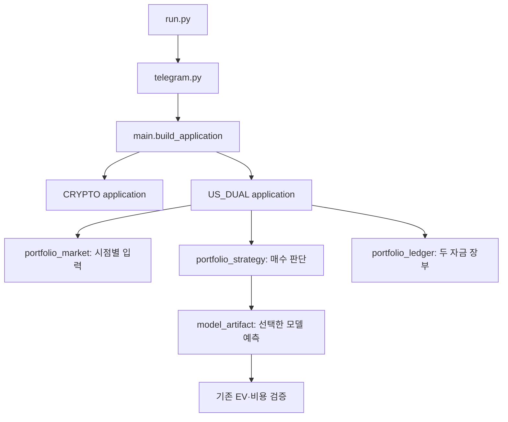

# AiPro 개발 상태·AI 연결·실전 준비도 감사

점검일: 2026-09-14. 대상: `sosamaru/Ai`.

현재 AiPro는 **테스트 가능한 모의운용·연구 시스템**입니다. 실제 시장에서 수익성이
검증된 자동매매 서비스는 아닙니다. 이번 작업에서는 기존 개발을 보존하면서 학습 결과를
모의운용에 연결하는 경로와 발견한 실행·검증 결함을 수정했습니다.

## 1. 무엇을 기준으로 점검했는가

- GitHub `main`: `6be27da5e8ba64d3f1ae162855b05c06f063c3bb`, 2026-07-31.
- 최신 미병합 개발: PR #75, `feat/us-dual-capital-20260912`,
  시작 커밋 `a282b4a8c40e3d3473d8ecd41861a4a57814e96e`.
- README, PROJECT_ROADMAP, US_DUAL_PORTFOLIO, SECURITY, FULL_BUILD_DIRECTIVE,
  MODERN_AI_TECHNOLOGY_PLAN, 실제 진입점·연구·계좌·통제 코드와 테스트를 대조했습니다.
- 변경 전 동일 환경에서 483개 테스트를 다시 실행해 통과를 확인했습니다.
- 과거 문서의 100%는 각각 명시한 구현 범위에 대한 기록입니다. 전체 서비스 완료율로
  합산하지 않습니다. Issue #48의 넓은 기술 목록과 Issue #63의 운영 증거는 계속 열려 있습니다.

## 2. 현재 수준 판단

| 영역 | 확인한 상태 | 판단 |
|---|---|---|
| 실행 진입점 | `run.py → telegram.py → main.py → TradingApplication` 유지 | 기본 연결 정상 |
| 코인 모의운용 | 도메인 전용 계좌·시세 상태·중단·재시작 관리 | 기존 경로 회귀 검증 |
| 미국 주식 분리 운용 | 단타 20만 원·장기 80만 원, 원자적 장부·비용·미결제·손실 중단 | 로컬 모의운용 구현 |
| AI 학습 | 로지스틱 회귀 및 선택적 부스팅/시퀀스 연구 실행기 | 학습 프로그램 존재 |
| 학습 결과 사용 | 이번에 숫자 JSON 저장·재로딩·동일 지표 예측 추가 | 명시적으로 선택한 US 단타 모델에 한정 |
| 검증된 실데이터 모델 | 제공된 데이터·검증 모델 없음 | 확인된 후보 0개 |
| 뉴스·거시·공시 | 공급자별 분석 구성 요소와 결합 함수 존재 | US_DUAL 자동 수집 연결은 미완료 |
| 실제 증권사 주문 | 별도 Alpaca PAPER 어댑터 존재, US_DUAL 주문과 미연결 | 실전 주문 경로 미완료 |
| 실제 장기 운용 증거 | 이번 점검에 실제 계좌 이력 제공 없음 | 확인된 필수 30일 증거 0일 |
| 실전 투입 | 계좌 대사·기업행사·운영 증거·독립 검토 미완료 | LIVE_READY 아님 |

따라서 ‘AI 개발이 몇 %인가’를 하나의 숫자로 제시하면 오해가 생깁니다.
소프트웨어 연결, 실제 학습 성능, 계좌 운영 검증은 서로 다른 완료 조건입니다.
이번 감사 구현 범위와 남은 작업은 PROJECT_ROADMAP.md에 별도로 기록합니다.

## 3. 파일들은 어떻게 연결되는가



화살표는 호출·의존 관계입니다. 도식의 거래는 로컬 모의 체결을 의미합니다.
학습 프로그램은 별도 실행하며 기존 운용 프로세스 안에서 자동 재학습하지 않습니다.

| 파일 | 역할과 연결 |
|---|---|
| `run.py` | 환경 파일을 읽은 뒤 기존 Telegram 실행 계층 호출 |
| `main.py` | 설정에 따라 코인 또는 US_DUAL 앱 생성 |
| `portfolio_application.py` | 위험 판단, 청산, 진입, 원자적 저장 순서 관리 |
| `portfolio_market.py` | 시간·시세·환율·세션·뉴스 입력 검증 |
| `portfolio_strategy.py` | 단타 돌파/VWAP/거래량, 장기 50/200일 추세, 선택적 예측 호출 |
| `portfolio_ledger.py` | 자금별 장부, 중복 방지, 재시작 복구, 감사 기록 |
| `model_features.py` | 학습·예측에 공통인 버전 고정 8개 시장 지표 |
| `model_dataset.py` | 과거 프레임에서 관측 가능한 입력과 겹치지 않는 미래 가격 정답 생성 |
| `model_training.py` | 시간순 교차검증, 최종 별도 평가, 비용 스트레스, 모델·보고서 출력 |
| `model_artifact.py` | 숫자 JSON 검증, SHA-256 고정, 적용 범위·만료·분포 이탈 검사 |
| `purged_training_runner.py` | 공통 CPU 학습 및 스케일링; 폴드별 새 모델 생성 |
| `cli.py` | 진단·테스트·모델 학습·확인·재생 명령 |

패키지 Python 파일 95개 중 명령 실행용 `__main__.py`를 제외한 **94개 모듈을
직접 import했고 실패는 0개**였습니다. AST에서 확인한 로컬 import 관계는 172개입니다.
이 숫자는 파일 참조 검사이며 모든 외부 API 조합이나 성능을 검증했다는 뜻은 아닙니다.

## 4. 발견한 문제와 수정

| 중요도 | 문제 | 수정 및 확인 |
|---|---|---|
| 높음 | 학습 정답의 구간이 테스트 정답과 겹치지 않아도 예측 시점에는 미확정일 수 있음 | 학습 정답 종료가 첫 예측 시점보다 앞서는지 검사 |
| 높음 | embargo를 기록하지만 후속 학습에서 제외하지 않음 | 이전 embargo 샘플을 이후 학습에서 실제 제외 |
| 높음 | 테스트 구간 중복으로 같은 샘플을 여러 번 집계 가능 | `step_size < test_size` 거부 |
| 높음 | 모든 학습 샘플이 제거되거나 한 클래스만 남은 경우 | 빈 학습과 한 클래스 학습을 명확히 거부 |
| 높음 | 모델 예외가 사이클을 중단해 필요한 청산까지 롤백할 수 있음 | 예측·검증 실패는 진입 보류로 처리, 다른 자금의 청산 계속 |
| 높음 | NaN 기대값이나 임계값이 비교문을 빠져나갈 수 있음 | 학습 비용·평가 정책·예측·PAPER 운영 증거의 유한값 검사 |
| 중간 | Telegram HTTP 오류 문자열에 토큰 URL 또는 공급자 본문 노출 가능 | 오류 유형만 기록하고 응답 크기 제한 |
| 중간 | 중첩 메시지 구조 오류·중복 업데이트 | 구조 검사, 엄격한 정수 ID, 중복·과거 ID 제외 |
| 중간 | US 입력이 없는데 콘솔 종료 코드가 성공 | 실패 코드와 진단 항목 추가 |
| 중간 | JSONL 한 줄을 전부 읽은 후 크기 검사 | 읽는 단계에서 8 MB 제한 |
| 중간 | Telegram 긴 대기 시간이 모의 사이클 주기를 늘림 | 요청 대기 시간을 설정된 사이클 간격 이하로 제한 |

실제 네트워크 지연·운영체제 스케줄링·프로세스 종료까지 이 수정으로 제거되지는 않습니다.
가격을 받지 못하거나 거래 정지 상태라면 설정한 손절 가격에 청산할 수 없습니다.

## 5. AI 모델 선택과 학습 설계

현재 자동 연결 대상으로 추가한 모델은 **L2 정규화 로지스틱 회귀**입니다.
기존 표준 라이브러리 학습기를 재사용하므로 GPU와 추가 런타임 패키지 없이 재현할 수 있습니다.
이는 수익성이 가장 좋다고 확인한 모델이라는 뜻이 아닙니다. 비교할 기준 모델을 먼저
실제로 저장·검증·호출할 수 있게 만든 선택입니다.

| 후보 | 현재 역할 | 다음 판단 기준 |
|---|---|---|
| 기존 규칙 | 학습 모델 미선택 시 기준 전략 | 실제 프레임 재생·비용 포함 성과 |
| 로지스틱 회귀 | 이번에 학습부터 US 단타 예측까지 연결 | 고정된 독립 평가 및 후속 모의운용 |
| XGBoost/LightGBM/CatBoost | 기존 선택적 폴드별 학습 어댑터 | 실제 라이브러리 실행, 동일 데이터·비용에서 기준 모델과 비교 |
| LSTM/GRU/Transformer encoder | 기존 선택적 연구 어댑터 | 충분한 데이터와 별도 환경에서 검증; 기본 실행에 자동 활성화하지 않음 |
| Random forest/ExtraTrees/ElasticNet | 후보 종류 선언·공통 인터페이스 수준 | 실제 학습 구현·검증을 별도 과제로 유지 |
| TFT/PatchTST/TCN·RL·자동 매매 LLM | 현재 운용 연결 대상에서 제외 | 데이터·비교 근거 없는 복잡도 증가를 피함; 주문 권한 부여 안 함 |

이번 환경에 XGBoost, LightGBM, CatBoost, PyTorch, TensorFlow는 설치되어 있지 않습니다.
기존 가짜 학습기를 사용하는 테스트와 실제 딥러닝 학습은 구분해야 합니다.
장기 80만 원은 기존 규칙을 유지합니다. 기업행사와 배당 포함 평가가 빠진 상태에서
장기 학습 모델을 실전용이라고 추가하는 것은 근거가 부족합니다.

학습·예측 규칙:

1. 종목별 US 시장 프레임을 시간순으로 읽습니다. 역순·중복 시점·합성/실데이터 혼합은 거부합니다.
2. 현재 시점의 단타 기준 전략을 통과한 입력에서만 지표를 추출합니다.
3. 기본 300초 후의 정확한 bid/환율 관측으로 markout 정답을 계산합니다.
   해당 시점이 없으면 보간하지 않고 건너뜁니다. 정답 구간은 겹치지 않습니다.
4. 최소 600개 정답 샘플, 최대 5,000개를 사용합니다. 부족한 샘플을 생성해 채우지 않습니다.
5. 마지막 약 20%는 최종 평가용으로 분리합니다. 앞부분에서 purged walk-forward 3개 폴드로 검증합니다.
6. 평균·표준편차·가중치·수익/손실 크기는 학습 데이터에서만 계산합니다.
   최종 평가를 마친 모델을 그대로 저장하고 평가 데이터로 재학습하지 않습니다.
7. 최종 평가 최소 100개, 선택 샘플 최소 30개, balanced accuracy ≥ 0.52,
   Brier ≤ 0.25 및 학습 비율 기반 상수 예측보다 우수, 비용 차감 기대값 양수,
   비용 두 배에서도 양수, 규칙 기준의 샘플당 markout보다 개선을 요구합니다.
8. 미달이면 보고서와 거절 사유를 저장합니다. 거절된 모델은 예측 실행기에 연결할 수 없습니다.
9. 명시적 모델 파일과 SHA-256을 설정해야 로딩합니다. 종목·정책·데이터 종류·지표가 맞아야 합니다.
10. 예측 시점은 검증 종료 이후여야 하며 검증 후 최대 7일, 학습 종료 후 최대 30일로 제한합니다.
    표준화 지표의 절댓값이 6을 넘으면 진입을 보류합니다. 이 기준은 검증용 설계값입니다.

**markout은 일정 시간 후 가격 변화입니다.** 실제 전략의 손절·추적 손절·미체결·자본 제약을
모두 반영한 계좌 수익률이 아닙니다. 이번 분류 확률을 하루 수익 확률로 읽으면 안 됩니다.
기존 실행기의 보유 기간이 예측 시간과 항상 일치하지도 않습니다. 반드시 별도 후속 기간의
전체 전략 재생과 모의계좌 검증이 필요합니다. 반복적으로 같은 최종 평가 데이터를 보고
튜닝하면 독립 평가가 아니며, 현재 프로그램은 서로 다른 작업 폴더의 재사용을 막는 중앙
실험 장부까지 제공하지 않습니다. CPCV·다중 검정·블록 부트스트랩은 여전히 연구 과제입니다.

## 6. 실행 방법

Python 3.11~3.13에서 기존 명령을 사용합니다.
이 변경은 PR #75의 `feat/us-dual-capital-20260912` 브랜치에 있으며 `main`에는
아직 병합하지 않았습니다. 실행할 코드를 해당 브랜치로 준비한 뒤 명령을 사용합니다.

```bash
python -m aipro all
python -m aipro portfolio-demo
```

실제 보관된 시세 입력이 준비되면, 예를 들어 AAPL 프레임을 학습합니다.
아래 티커는 명령 형식 예시이며 투자 추천이 아닙니다.

```bash
python -m aipro model-train data/us_frames.jsonl --symbol AAPL --output-dir data/models/aapl --horizon-seconds 300
python -m aipro model-inspect data/models/aapl/model.json
```

출력은 `model.json`과 `training_report.json`입니다. 규격은 `MarketFrame.to_dict()`의
JSONL이며 기존 US_DUAL_PORTFOLIO.md에 정의돼 있습니다. 소스 데이터와 출력 경로를
분리합니다. 학습 보고서의 `synthetic`, `qualified`, `blockers`, `validation`을 확인합니다.
숫자 JSON을 사용하며 pickle/joblib 객체는 불러오지 않습니다.

검증한 실데이터 모델을 로컬 모의운용에서 사용하려면 로컬 환경에 설정합니다.

```dotenv
AIPRO_RUNTIME=US_DUAL
AIPRO_MODE=PAPER
AIPRO_US_FRAME_PATH=data/us_current_frame.json
AIPRO_US_DUAL_DB_PATH=data/us_dual_paper.sqlite3
AIPRO_US_MODEL_PATH=data/models/aapl/model.json
AIPRO_US_MODEL_SHA256=<model.json 최상위 fingerprint 값>
AIPRO_PAPER_INTERVAL_SECONDS=10
```

```bash
python -m aipro doctor --require-pytest
python run.py
```

이 SHA-256은 숫자 JSON 내용의 지문이며 작성자 서명이 아닙니다. 원격에서 자동으로
모델을 다운로드하거나 교체하지 않습니다. 모델을 바꾸려면 명시적으로 파일·지문을
선택하고 프로세스를 재시작합니다. 한 파일은 한 종목의 단타 전용이며 다른 종목의
모델 예측은 보류합니다. 장기 전략은 따로 유지됩니다.

모델을 후속 데이터로 재생할 때:

```bash
python -m aipro portfolio-replay data/us_later_frames.jsonl --output data/later_report.json --model data/models/aapl/model.json --model-sha256 <fingerprint>
```

합성 모델은 기본 운용에서 거부하며, 명시적인 합성 재생에서만
`--allow-synthetic-model`을 사용할 수 있습니다. 합성 모델과 실제 프레임을 섞을 수 없습니다.
실데이터 모델이 없으면 모델 경로/지문은 비워 두고 기존 미학습 규칙으로 모의실행합니다.
미국 주식 입력 공급기는 여전히 준비해야 하며 이 명령이 공급자 계정이나 시세를 생성하지 않습니다.

## 7. 실전 사용 전 남은 필수 작업

| 우선순위 | 필요한 일 | 현재 완료하지 못한 이유 |
|---|---|---|
| P0 | 미국 주식 증권사/API와 시세·환율·달력 공급원 연결 | 실제 계좌 조건·인증·공급원 미확정 |
| P0 | USD 계좌·실제 결제 현금·주문 상태 대사 | 현재 장부는 가상 KRW; 증권사 실제 기록 필요 |
| P0 | 분할·배당·합병·상장폐지·세금·수정주가 정책 | 실제 공급자 이벤트 명세와 회계 정책에 맞춘 구현 필요 |
| P1 | 원시 데이터 보관과 시점별 종목 편입·뉴스·공시 데이터 검증 | 생존편향·시간 오염 없는 데이터가 제공되지 않음 |
| P1 | 기준/학습 모델의 독립 기간 전체 포트폴리오 비교 | 합성 테스트 외 실데이터 성능 증거 없음 |
| P1 | 최소 30일 실제 PAPER 관찰·위험/주문/대사 증거 | 실제 시간과 계정이 필요함 |
| P1 | 실행 호스트 감시·백업 복구 훈련·운영 로그 보존 | 사용자 PC/VPS와 서비스 감독 환경 미확인 |
| P2 | 중앙 실험 장부, CPCV/다중 검정/블록 부트스트랩, 상관·꼬리위험 검증 | 넓은 연구·포트폴리오 검증 범위는 미완료 |
| 승인 전 | SMTP/TOTP·Upbit 감독 검사·독립 LIVE 검토 | 기존 필수 조건 그대로 유지 |

이번 변경은 실전 주문을 전송하지 않았습니다. 하루 +2%는 단타 자금의 중단 목표이고
달성 예측이 아닙니다. 최초 외부 지원금 100만 원 상한과 두 자금의 분리는 유지합니다.
모든 기술을 추가하면 완성되는 것이 아니라 실제 데이터와 계좌 조건에서 검증해야 합니다.

## 8. 검증 근거와 한계

로컬 `python -m aipro all`은 진단·컴파일·PAPER 진입점·통합 121개·전체 534개
테스트를 경고 없이 통과했습니다. 변경 전 483개에서 51개 회귀 사례가 추가되었습니다.
합성 포트폴리오 데모는 4개 프레임, 가상 체결 3건, 차단 프레임 0개를 확인했습니다.
[GitHub CI #247](https://github.com/sosamaru/Ai/actions/runs/34837903368)에서 구현 커밋
`ed050678365f06b8d305c5ec045d0fd0bcd4f2a5`의 Python 3.11·3.12·3.13 전체 단계가
통과했습니다. 후속 문서 커밋도 동일한 검증 조건을 적용하며 main에는 병합하지 않았습니다.
새 테스트는 실제 숫자 학습·저장·재로딩·예측, 독립 평가 오염 방지, 만료·출처·지표 이탈,
잘못된 모델/메시지 입력, 자금 보존과 위험 청산 연결을 확인합니다.
이 테스트의 합성 정답은 소프트웨어 검증을 위한 인위적인 관계이며 경제적 발견이 아닙니다.
사용자 Windows/VPS와 실제 공급자 인증·망 상태는 이번 Linux 테스트로 검증되지 않습니다.

데이터 누수와 동일 전처리 적용 원칙은
[scikit-learn 공식 문서](https://scikit-learn.org/stable/common_pitfalls.html)를 참조했습니다.
시간순 검증에서 train/test 간격을 두는 일반 원칙은
[TimeSeriesSplit 공식 문서](https://scikit-learn.org/stable/modules/generated/sklearn.model_selection.TimeSeriesSplit.html)에 설명돼 있습니다.
AiPro의 purging/embargo는 프로젝트 코드로 구현하며 해당 라이브러리를 사용한 것으로 표시하지 않습니다.
모의거래와 실거래의 차이는
[Alpaca 공식 PAPER 문서](https://docs.alpaca.markets/us/docs/paper-trading)를 참고했습니다.
모의 체결은 실제 시장 충격·주문 대기열 등을 모두 반영하지 않으므로 운영 검증과 분리합니다.
